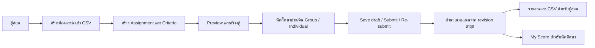
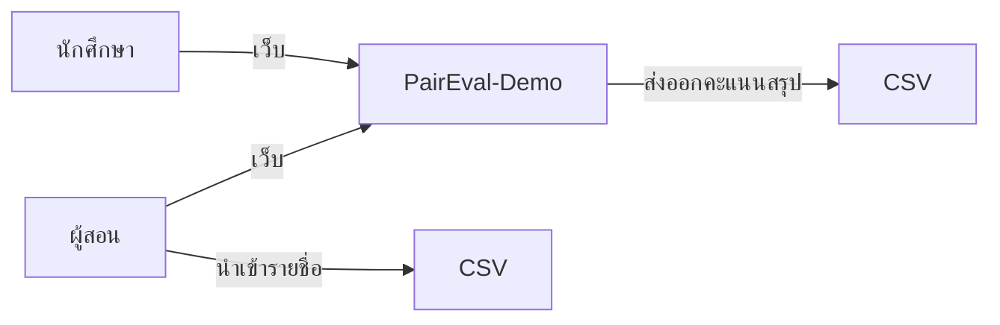
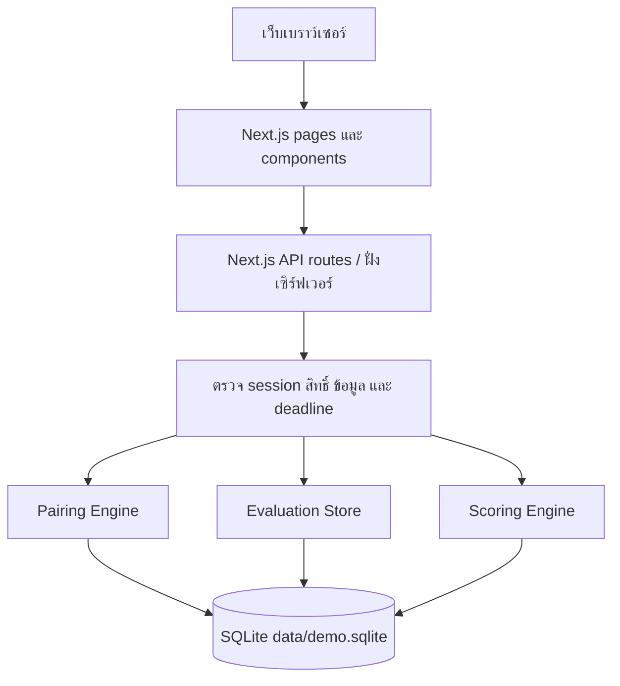
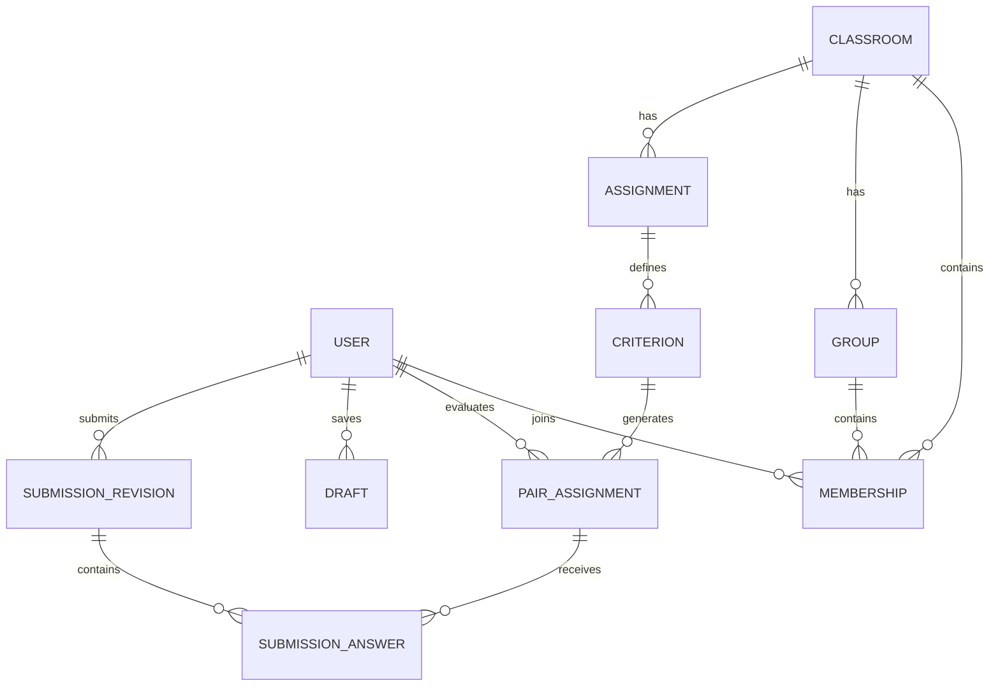

# 00 — ภาพรวมระบบ PairEval

> **ฐานข้อกำหนดระบบเต็ม:** [PRD v2.1](pairwise_evaluation_prd%201.md). เอกสารนี้เทียบเป้าหมายดังกล่าวกับ PairEval-Demo ที่ทำงานได้ ณ 28 กันยายน 2026  
> **ติดตาม:** [Traceability Matrix](12_Traceability%20Matrix.md) · [Decisions Needed](13_Decisions%20Needed.md) · [แผน Demo](../../../SPDX-Lab/Project%20Plan/Plan%20-%20Demo.md)

## วัตถุประสงค์ของระบบ

PairEval ช่วยประเมินผลงานนักศึกษาด้วย **Pairwise Comparison**: ผู้ประเมินเลือกว่าระหว่าง A กับ B รายการใดดีกว่าตามเกณฑ์ แล้วระบบรวมผลเป็นคะแนน ระบบรองรับการเปรียบเทียบ **กลุ่มกับกลุ่ม** และ **นักศึกษากับเพื่อนในกลุ่มเดียวกัน** เป้าหมายของเดโมคือเดินกระบวนการตั้งแต่สร้างห้องเรียนจนถึงรายงานคะแนน โดยใช้ **ข้อมูลสังเคราะห์เท่านั้น**

### ปัญหาและเป้าหมายของระบบเต็ม (PRD หัวข้อ 1)

PRD ระบุปัญหา 3 เรื่อง: **absolute scoring bias** จากมาตรฐานคะแนนไม่คงที่, **free-rider** ที่ได้คะแนนกลุ่มเท่ากันทั้งที่มีส่วนร่วมต่างกัน, และ **peer rating inflation** จากการให้คะแนนเพื่อนสูงคล้ายกันหมด เป้าหมาย G1–G5 คือใช้ข้อมูลเปรียบเทียบคู่ ลดอคติ, แยกผลงานรายคน, ให้อาจารย์ตรวจ/แทรกแซงผล, ปกป้องตัวตนผู้ประเมิน และให้นักศึกษาใช้เวลาไม่เกิน 15 นาทีต่องาน

| ตัวชี้วัดความสำเร็จหลังใช้งานจริง 1 ภาคการศึกษา (หัวข้อ 1.4) | เป้าหมาย |
|---|---:|
| M1 นักศึกษาส่งครบตามงานที่มอบหมาย | ≥ 90% |
| M2 เวลาใช้งานมัธยฐานต่องาน | ≤ 15 นาที |
| M3 การกระจายคะแนน Individual ภายในกลุ่ม (คะแนนเต็ม 5) | SD ≥ 0.5 คะแนน |
| M4 สัดส่วนคะแนนที่ผู้สอน Override | ≤ 5% |
| M5 สัดส่วนนักศึกษาที่ยื่น Appeal | ≤ 3% |
| M6 สัดส่วน item ที่มี comparison ต่ำกว่าเกณฑ์ | ≤ 5% |

ตัวเลข M1–M6 ในตารางนี้เป็น **success metrics** ต่างจากชื่อ Milestone M1–M4 ในแผนปล่อยระบบ (หัวข้อ 19); เดโมยังไม่มีผลวัดหลังใช้จริง

## ขอบเขตของระบบ

| ส่วนงาน | ทำงานแล้วในเดโม | ยังไม่ครบสำหรับระบบเต็ม |
|---|---|---|
| ห้องเรียน/งาน | สร้างห้องจาก CSV `email,groupname`, ตรวจข้อมูล, สร้างงานพร้อมคะแนนสูงสุด เกณฑ์ น้ำหนัก และ deadline แยก Group/Individual | Roster ตาม schema v2.1, อาจารย์ร่วม/TA, artifact ต่อ item, Assignment lifecycle และย้ายกลุ่มแบบมี audit |
| จัดคู่ | Preview และสร้างคู่ Group/Individual โดยตั้งเป้า 5 ผู้ประเมินที่ต่างกันต่อคู่ต่อเกณฑ์ เมื่อมีผู้มีสิทธิ์เพียงพอ | Feasibility แบบ constrained matching, ลด coverage ตามจริง, จำกัด workload, สุ่มซ้าย/ขวา, สร้างคู่ตอน Publish |
| ประเมิน | ตอบระดับ 1–6, Save draft, Submit และ Re-submit ก่อน deadline พร้อมตรวจสิทธิ์ฝั่งเซิร์ฟเวอร์ | Autosave, ผู้สอนประเมินเอง, artifact ของทั้งสองฝั่ง และการแจ้งเตือน |
| คะแนน/รายงาน | คำนวณจาก revision ที่ส่งล่าสุดด้วยสูตร normalize ของเดโม, รายงานผู้สอน, คะแนนเฉพาะตน และ CSV summary | สูตร v2.1 แบบ band mapping + participation multiplier, k-anonymity, quality report, Finalize snapshot และ Excel `.xlsx` |
| การเข้าถึง | Session บัญชีสังเคราะห์และตรวจบทบาท/เจ้าของข้อมูล | Google OIDC, role/resource authorization, privacy controls และ audit log |

“ทำงานแล้ว” หมายถึงฟังก์ชันที่อ่าน/บันทึกข้อมูลจริงในเดโม ตาม [README](../../README.md) และ [ผลตรวจวันที่ 7](../day-07.md) ไม่ได้หมายถึงพร้อมใช้กับข้อมูลจริง

**นอกขอบเขตระบบเต็มรุ่นแรกตาม PRD หัวข้อ 1.3/หัวข้อ 2.2:** ไม่แทน LMS/gradebook หลัก, ไม่ตัดเกรดตัวอักษร, ไม่ให้คะแนนแบบ rubric ตรง, ไม่ประเมินข้ามห้อง; ยังไม่ทำ native mobile app, UI หลายภาษา, LMS/LTI integration หรือโมเดล Bradley–Terry/Elo. [OQ-5](13_Decisions%20Needed.md) เลือก Export แทน LMS สำหรับพัฒนา v1.0

**สมมติฐาน A1–A5 และข้อจำกัด C1–C3 (หัวข้อ 2):** นักศึกษามีบัญชี Google มหาวิทยาลัย, กลุ่มขนาด 3–8, ห้องละไม่เกิน 200 คน/40 กลุ่ม, ผู้สอนมีอำนาจตัดสินคะแนนสุดท้าย และผู้ประเมินเข้าถึงผลงานของคู่ที่ต้องดูได้; ต้องใช้โครงสร้างพื้นฐานที่มหาวิทยาลัยอนุมัติ ปฏิบัติตามกฎหมายข้อมูลส่วนบุคคล และคุมขอบเขตงานให้ทำได้ภายในหนึ่งภาคการศึกษา

## ผู้ใช้งานและผู้เกี่ยวข้อง

| บทบาท | งานหลักในเดโม |
|---|---|
| **Instructor (ผู้สอน)** | สร้างห้อง/งาน ตรวจความเป็นไปได้และสร้างคู่ ดูรายงาน ดาวน์โหลด CSV |
| **Student (นักศึกษา)** | ตอบคู่ที่ได้รับมอบหมาย บันทึกร่าง ส่ง/ส่งใหม่ ดูคะแนนเฉพาะตน |
| **ผู้ดูแลการสาธิต** | เตรียมและรีเซ็ตข้อมูลสังเคราะห์; ไม่ใช่บทบาทผู้ใช้ในแอป |

PRD v2.1 ยังมี **Owner, Co-teacher, TA และ SYSTEM_ADMIN** พร้อมสิทธิ์ต่างกัน; ดู [Use Case](02_Use%20Case%20Diagram_ผู้ใช้ทำอะไรได้บาง.md)

## ภาพรวมการใช้งาน (User Flow)

1. ผู้สอนนำเข้ารายชื่อและกลุ่มจาก CSV; ระบบปฏิเสธทั้งไฟล์ถ้าข้อมูลผิด
2. ผู้สอนสร้าง Assignment โดยกำหนดคะแนน Group/Individual, criteria ซึ่งน้ำหนักแต่ละส่วนรวม 100% และ deadline แยกกัน
3. ระบบแสดง Pairing preview: target, ผู้มีสิทธิ์, จำนวนที่จะสร้าง และเหตุผลเมื่อจัดไม่ได้ ผู้สอนสั่งบันทึกคู่ทั้งงาน
4. นักศึกษาเลือกคำตอบ 1–6 ต่อคู่ บันทึก Draft หรือ Submit; ก่อน deadline สามารถ Re-submit เป็น revision ใหม่
5. ระบบคิดคะแนนจาก revision ล่าสุดที่ส่งแล้ว ผู้สอนดูรายงานและ CSV; นักศึกษาเห็น My Score ของตน

## ภาพรวมส่วนประกอบของระบบ

### System Context

### System Architecture ของเดโม

แอปใช้ Next.js/TypeScript และ SQLite ในเครื่องเดียวกัน คู่และคำตอบถูกบันทึกในฐานข้อมูล ส่วนคะแนนคำนวณจากข้อมูลที่ส่งแล้วเมื่ออ่านรายงานหรือคะแนน ไม่มีคะแนนคงที่ฝังในหน้าจอ

## ระบบหรือบริการภายนอกที่เชื่อมต่อ

เดโม **ไม่ต้องเชื่อมบริการภายนอกขณะใช้งาน** CSV เป็นช่องทางนำเข้า/ส่งออกไฟล์ ระบบเต็มตาม PRD v2.1 ต้องเชื่อม Google OIDC, บริการแจ้งเตือน และโครงสร้างเก็บข้อมูล/บันทึก audit; LMS ไม่อยู่ใน v1.0 ตาม [OQ-5](13_Decisions%20Needed.md)

## ข้อมูลหลักที่ระบบจัดการ (Conceptual Data Diagram)

`PAIR_ASSIGNMENT` ระบุว่าใครประเมินคู่ A–B ตามเกณฑ์ใด `DRAFT` ยังไม่ถือว่าส่ง ส่วน `SUBMISSION_REVISION` เก็บแต่ละครั้งที่ส่ง และใช้รุ่นล่าสุดคิดคะแนน **ภาพนี้อธิบายเดโม**; ตารางและคีย์จริงของเดโมดูจาก [schema ที่ใช้ seed](../../scripts/seed.mjs) ส่วนแบบข้อมูลระบบเต็มดู [ER Diagram](04_ER%20Diagram_ฐานข้อมูลสัมพันธ์.md)

## ข้อกำหนดและข้อจำกัดสำคัญ

- Group evaluator ต้องไม่อยู่ในกลุ่ม A หรือ B; Individual evaluator ต้องเป็นเพื่อนร่วมกลุ่มที่ไม่ใช่ A หรือ B
- หากคู่ใดไม่มีผู้มีสิทธิ์ครบ target 5 ระบบไม่สร้างคู่ของ Assignment นั้นเลย; ห้อง 2 กลุ่ม × 2 คนเป็นตัวอย่างที่จัดไม่ได้
- เดโมใช้คำตอบ 6 ระดับ; ไม่มีตัวเลือก “เท่ากัน”
- Draft ไม่นับคะแนน; การส่งบางคู่ปรับคะแนนส่วนของผู้ส่งตาม `answered / assigned`; ไม่ส่งเลยได้ 0 ในส่วนนั้นเมื่อมีคู่ที่มอบหมาย
- ข้อมูลไม่พอแสดง `NO_DATA`; คะแนนก่อนพ้น deadline เป็น `Interim`
- ทุกคนเลือกบัญชีสังเคราะห์จากหน้าแรกได้ จึงห้ามใช้เดโมกับข้อมูลหรือคะแนนจริง

## ข้อสรุปสำหรับพัฒนาและเรื่องที่ยังต้องรับรอง

PRD v2.1 ปิดข้อขัดกันเดิมบางเรื่องแล้ว เช่น เลือก 6 ระดับและใช้ band mapping. [Decisions Needed](13_Decisions%20Needed.md) ตอนนี้มีข้อสรุปสำหรับพัฒนา OQ-1–8/DQ-09–14 พร้อมเหตุผล แต่บางข้อยังต้องรับรองนโยบายหรือแก้ PRD; ยังไม่มีหลักฐานว่าระบบเต็มทำงานแล้ว. เดโมยังคงใช้กติกาเฉพาะใน [แผน Demo](../../../SPDX-Lab/Project%20Plan/Plan%20-%20Demo.md)

ศัพท์ภาษาอังกฤษในเอกสารนี้อธิบายใน [Glossary in System](Glossary%20in%20System.md)

## แผนส่งมอบระบบเต็ม (PRD หัวข้อ 19)

| Milestone | สิ่งที่ต้องตรวจได้ |
|---|---|
| **M1 Walking Skeleton** | Login → ห้อง/roster → assignment → pairing → ประเมินหนึ่งเกณฑ์ → คะแนน พร้อม AuthZ, anonymity ขั้นต้น และ audit เหตุการณ์บังคับ บน staging |
| **M2 Core Complete** | Group/Individual, scoring หัวข้อ 9, participation, reports และ CSV; ทดลองห้องจริงขนาดเล็กตามเงื่อนไขอนุมัติ |
| **M3 Trustworthy** | k-anonymity, quality signals, audit viewer/integrity review, override และ appeals ผ่าน security/privacy review |
| **M4 Production Ready** | Notifications, XLSX, accessibility AA และ load test สำหรับห้อง 200 คน |

นี่เป็นแผนของ PRD v2.1 ไม่ใช่สถานะเดโมปัจจุบัน; คำถามและข้อขัดกันที่กระทบการส่งมอบอยู่ใน [Decisions Needed](13_Decisions%20Needed.md)
