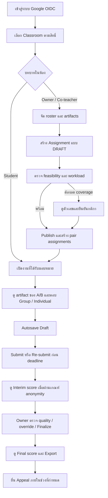

# 01 — User Flow: ผู้ใช้ทำอะไรตามลำดับ

**ฐานอ้างอิง:** [PRD v2.1](pairwise_evaluation_prd%201.md) หัวข้อ 3, หัวข้อ 7, หัวข้อ 12, หัวข้อ 19 · **สถานะ:** แบบออกแบบของระบบเต็ม ยังไม่ใช่เส้นทางที่ PairEval-Demo ทำได้ครบ

## เส้นทางหลัก

## จุดแยกและผลลัพธ์ที่ต้องอธิบายแก่ผู้ใช้

| จุด | พฤติกรรมเป้าหมาย | PRD |
|---|---|---|
| นำเข้า roster | Preview ข้อผิดพลาดเป็นรายแถว; มีแถวผิดแล้วไม่บันทึกทั้งไฟล์; ผู้ยังไม่ login เป็น `PENDING` | FR-CLASS-01–05 |
| ก่อน Publish | ตรวจน้ำหนักเกณฑ์, artifact, eligibility, coverage และ workload; เมื่อเป้าหมายเป็นไปไม่ได้แสดงค่าที่ทำได้จริง | FR-ASSIGN-01–08, FR-PAIR-01–05 |
| หลัง Publish | หากต้องแก้ roster/criteria ให้ Unpublish พร้อมเตือนผลต่อคำตอบและบันทึก audit ก่อนสร้างคู่รุ่นใหม่ | FR-ASSIGN-03, FR-PAIR-11, FR-AUDIT-01 |
| ระหว่างประเมิน | แสดงคู่ที่ได้รับเท่านั้น; autosave แล้วแจ้งเวลาที่บันทึก; Submit ได้แม้ตอบไม่ครบ; ส่งใหม่ได้ก่อน deadline | FR-EVAL-01–11 |
| หลัง Deadline | อ่านคำตอบได้แต่แก้/ส่งไม่ได้; คะแนนยังเป็น Interim จนผ่านการตรวจและ Owner Finalize | FR-EVAL-08, FR-SCORE-05–09 |
| หลัง Finalize | นักศึกษาเห็นคะแนนตนตาม anonymity policy; ผู้สอนส่งออกรายงาน; นักศึกษายื่น appeal ได้ | FR-REPORT-06, FR-EXPORT-01–06, FR-APPEAL-01–02 |

**ความต่างจากเดโม:** เดโมเลือกบัญชีสังเคราะห์, สร้างคู่ด้วยปุ่มแยกหลังสร้างงาน, ใช้ Save draft แบบกดเอง และยังไม่มี Publish/Finalize/Appeal/Notification; ดู [ภาพรวม](00_Overview_ภาพรวมระบบ.md). [OQ-3/4](13_Decisions%20Needed.md) มีข้อสรุปเพื่อพัฒนาเรื่อง auto-finalize ทั้งงานและสถานะ WITHDRAWN แล้ว แต่ยังต้องรับรองกระบวนการถอนรายวิชาก่อนใช้ข้อมูลจริง
