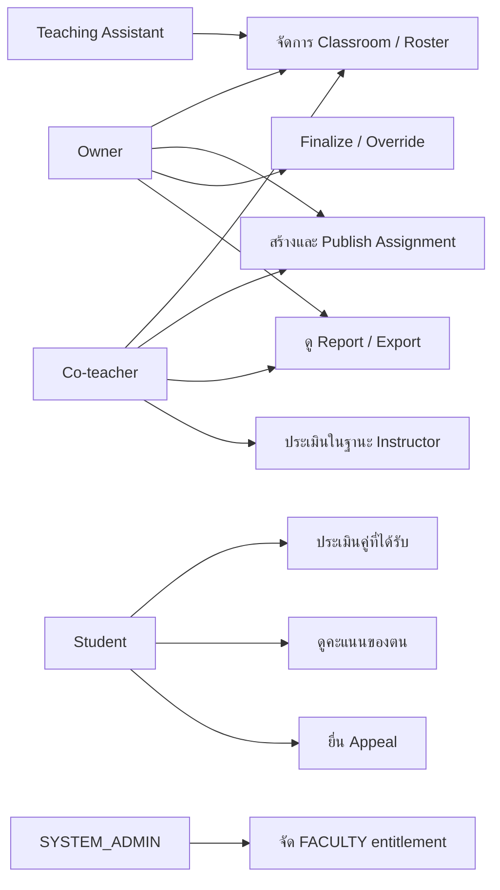

# 02 — Use Case และสิทธิ์ผู้ใช้

**ฐานอ้างอิง:** [PRD v2.1](pairwise_evaluation_prd%201.md) หัวข้อ 3, หัวข้อ 7.1–7.2, หัวข้อ 14 · **สถานะ:** แบบออกแบบของระบบเต็ม

| ความสามารถ | Owner | Co-teacher | TA | Student | SYSTEM_ADMIN |
|---|:---:|:---:|:---:|:---:|:---:|
| สร้าง Classroom | เมื่อมี FACULTY | — | — | — | สร้างแทนโดยระบุ FACULTY owner |
| จัด roster | ✓ | ✓ | ✓ | — | — |
| สร้าง/แก้ Assignment | ✓ | ✓ | — | — | — |
| ประเมินคู่ | ✓ | ✓ | — | คู่ของตน | — |
| ดูรายงาน/Export | ✓ | ✓ | — | — | — |
| Finalize/Override | ✓ | — | — | — | — |
| ดูคะแนนตน/Appeal | — | — | — | ✓ | — |
| จัด entitlement | — | — | — | — | ✓ |

ทุกกรณีต้องตรวจ role และ classroom/resource scope **ที่ API** ตาม FR-AUTHZ-01–04 และ FR-API-06 ไม่อาศัยการซ่อนปุ่มอย่างเดียว นักศึกษาไม่เห็นตัวตนผู้ประเมินไม่ว่าผ่านหน้าเว็บ API หรือ export (FR-ANON-01); [OQ-7](13_Decisions%20Needed.md) เลือกให้ Co-teacher เห็นเฉพาะ pseudonym ส่วน Owner เปิดตัวตนจริงเมื่อจำเป็นพร้อม audit. นี่เป็นข้อสรุปเพื่อพัฒนา ยังไม่ใช่การรับรองของผู้สอน

**ความต่างจากเดโม:** เดโมมีเพียง Instructor/Student และ session สังเคราะห์; ยังไม่มี OIDC, FACULTY, Co-teacher, TA, SYSTEM_ADMIN, appeal และการอ่าน evaluator identity แบบ audit
