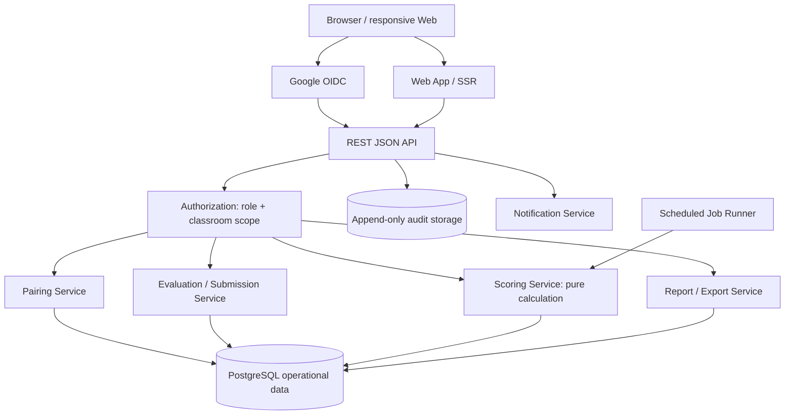

# 03 — System Architecture

**ฐานอ้างอิง:** [PRD v2.1](pairwise_evaluation_prd%201.md) หัวข้อ 6, หัวข้อ 12–14 · **สถานะ:** สถาปัตยกรรมเป้าหมายของระบบเต็ม ไม่ใช่การติดตั้งเดโม

| ขอบเขต | หน้าที่ | ข้อกำหนด |
|---|---|---|
| OIDC/Auth | ตรวจ token, `sub`, verified email และ session | FR-AUTH-01–04, D9 |
| API/Authorization | ตรวจ role, resource scope, ownership, rate limit และ error shape | FR-AUTHZ-01–04, FR-API-01–07, AR-02 |
| Pairing | ตรวจ feasibility และสร้างคู่ deterministic ก่อน Publish | FR-PAIR-01–15 |
| Evaluation | Autosave, Submit แบบ idempotent, เก็บ revision | FR-EVAL-01–13, DR-01/06 |
| Scoring/Reports | คำนวณตาม formula version, interim/final snapshot, รายงาน | FR-SCORE-01–13, FR-REPORT-01–06, AR-01 |
| Audit/Notification | เก็บเหตุการณ์สำคัญแบบ append-only และแจ้งผู้เกี่ยวข้อง | FR-AUDIT-01–03, FR-NOTIF-01–06, AR-03 |

**ขอบเขตข้อมูล:** operational data กับ audit storage แยกกัน; ไม่มีสิทธิ์อ่าน evaluator identity โดยอัตโนมัติสำหรับ SYSTEM_ADMIN; secret อยู่ใน secret manager และบริการจริงต้องใช้ HTTPS (FR-SEC-01/06) ข้อกำหนดความเร็ว ความพร้อมใช้ และขนาดอยู่ใน [Rules](08_Rules%20เงื่อนไขสำคัญ.md)

**ข้อสรุปเพื่อพัฒนา:** [OQ-5](13_Decisions%20Needed.md) ใช้ Export แทน LMS/LTI ใน v1.0; [DQ-14](13_Decisions%20Needed.md) ให้เก็บ URL HTTPS ต่อ item/side และตรวจสิทธิ์ที่ PairEval ก่อนแสดงปุ่มเปิดผลงาน แต่แหล่งเก็บไฟล์จริง/สิทธิ์ข้ามระบบยังเป็น production gate ที่ IT และผู้ดูแลข้อมูลต้องรับรอง. Staging ใช้ผลงานสังเคราะห์เท่านั้น

**ความต่างจากเดโม:** PairEval-Demo เป็น Next.js + SQLite ในเครื่องเดียว ใช้ session บัญชีตัวอย่าง ไม่มี OIDC, PostgreSQL, audit storage แยก, scheduled job หรือ notification service
