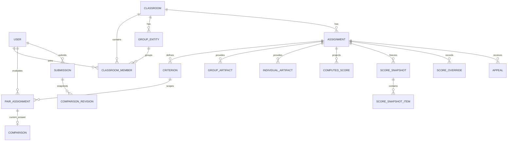

# 04 — ER Diagram และกฎข้อมูล

**ฐานอ้างอิง:** [PRD v2.1](pairwise_evaluation_prd%201.md) หัวข้อ 11 · **สถานะ:** โมเดลเป้าหมายของระบบเต็ม; schema ของ PairEval-Demo ต่างจากนี้

| กลุ่มข้อมูล | คีย์/เงื่อนไขสำคัญ | PRD |
|---|---|---|
| `user`, `classroom_member` | verified email ใช้เชื่อมครั้งแรก, `google_sub` เป็นตัวตนหลัก; membership ระบุ role/group และสถานะ `WITHDRAWN` พร้อมเวลามีผลตาม OQ-4 | FR-AUTH-03, FR-AUTHZ-03, หัวข้อ 11.1 |
| `assignment`, `criterion` | สถานะงาน, deadline UTC, config สูตร/คู่, น้ำหนักเกณฑ์รวม 100% ต่อ side | FR-ASSIGN-01–08, DR-05 |
| `group_artifact`, `individual_artifact` | URL ต่อ item/assignment/side และต้องอยู่ classroom เดียวกัน | FR-ASSIGN-08, DR-08 |
| `pair_assignment` | pair เก็บ canonical order, evaluator, `display_left`, `generation`; unique ต่อ pair/evaluator/criterion/generation; Unpublish ปิด generation โดยไม่ลบประวัติ | FR-PAIR-07–09, DR-02/07, DQ-09 |
| `comparison`, `submission`, `comparison_revision` | คำตอบปัจจุบันแยกจาก snapshot เมื่อ Submit; revision เก่าแก้ไม่ได้; submit เป็น transaction เดียว | FR-EVAL-04–09, DR-01/06 |
| `computed_score`, `score_snapshot`, `score_override` | interim projection เปลี่ยนได้, snapshot final ไม่แก้, override แยก record พร้อมเหตุผล | FR-SCORE-08–10, DR-03/04 |
| `audit_event` | อยู่ audit storage แยก มี logical resource ID; ไม่มีสิทธิ์ UPDATE/DELETE | FR-AUDIT-01–03, DR-09 |
| `notification`, `appeal` | เก็บสถานะส่ง/อ่าน และการยื่น/ตอบอุทธรณ์ | FR-NOTIF-01–06, FR-APPEAL-01–02 |

ข้อบังคับที่ควรลงฐานข้อมูลและทดสอบ: `DR-01` ถึง `DR-09` ใน PRD หัวข้อ 11.2 โดยเฉพาะการเลือกเฉพาะ submission ล่าสุด, canonical pair, immutable snapshot, เวลา UTC และการบันทึกแบบ atomic ดู [Sequence](05_Sequence%20Diagram_ระบบคุยกัน.md) สำหรับจังหวะธุรกรรม

**ผลของ DQ-13:** ไม่เพิ่ม `opens_at` โดยไม่มีข้อกำหนด; เมื่อ Publish สำเร็จให้ OPEN ทันที. เก็บ deadline Group/Individual เป็น UTC และแสดงตาม timezone ของห้อง. Schema สำหรับ `WITHDRAWN` และ active generation ยังเป็นแบบออกแบบ ต้องยืนยัน migration/ข้อจำกัดจริงก่อนใช้งาน

**ความต่างจากเดโม:** เดโมมี `evaluation_drafts`, `submission_revisions`, `submission_answers` ใน SQLite แต่ยังไม่มี artifact, publish generation, immutable score snapshot, override, audit storage, notification หรือ appeal
