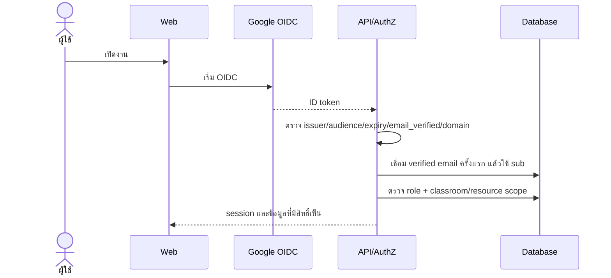
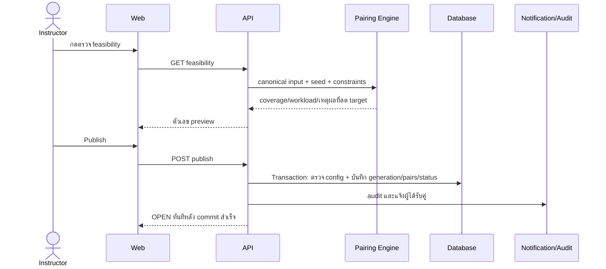
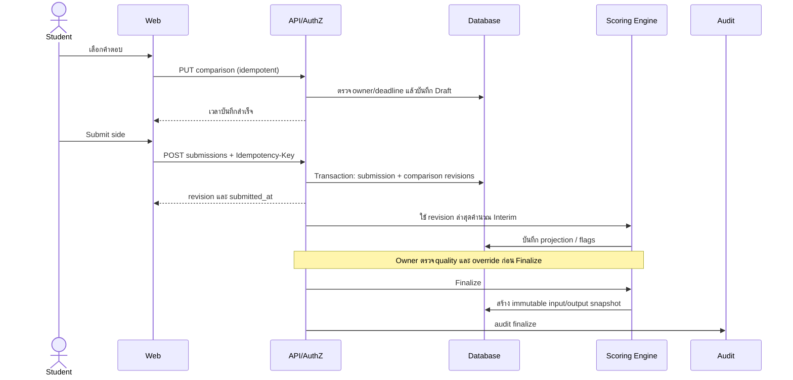

# 05 — Sequence Diagram: การคุยกันในงานสำคัญ

**ฐานอ้างอิง:** [PRD v2.1](pairwise_evaluation_prd%201.md) หัวข้อ 7–12 · **สถานะ:** ลำดับเป้าหมายของระบบเต็ม

## Login และเปิดงาน

อ้างอิง FR-AUTH-01–04, FR-AUTHZ-01–04, D9; หาก resource ต่าง classroom ต้องตอบโดยไม่เปิดเผยว่ามี resource นั้น (FR-AUTHZ-02)

## Preview, Publish และสร้างคู่

อ้างอิง FR-PAIR-01–11, INV-G1/INV-I1/INV-2–6, FR-ASSIGN-02–03; ถ้าธุรกรรมล้มเหลวต้องไม่เหลือคู่บางส่วน

**Unpublish/Re-publish ตาม DQ-09:** ปิด generation เดิมแบบ soft-invalidate พร้อมเหตุผลและ audit; อย่าลบ submitted comparison/snapshot. การแก้ roster/criteria ทำใน DRAFT แล้ว Publish สร้างคู่รุ่นใหม่แบบ transaction และแจ้งผู้ได้รับผลกระทบ

## Autosave, Submit, คำนวณ และ Finalize

อ้างอิง FR-EVAL-04–09, FR-API-01–03, DR-01/03/06, FR-SCORE-01–10, FR-AUDIT-01–03; การส่งหลัง deadline หรือคู่ที่ไม่ได้รับมอบหมายต้องถูกปฏิเสธที่ API

**OQ-3:** งาน scheduled ตรวจเมื่อพ้น deadline สุดท้าย 14 วัน; finalize **ทั้ง Assignment** เมื่อไม่มี LOW_CONFIDENCE, appeal ค้าง หรือ validation error. มิฉะนั้นคง CLOSED และแจ้ง Owner; ทุกกรณีต้อง idempotent และบันทึก audit actor ของระบบ

**ความต่างจากเดโม:** เดโมมีการกด Save draft เอง, Submit/Re-submit และคำนวณคะแนนเมื่ออ่านรายงาน แต่ยังไม่มี OIDC, publish, autosave, scoring job, Finalize snapshot หรือ notification
