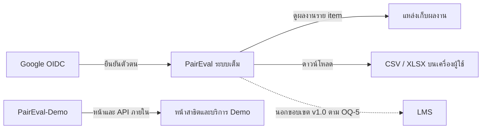

# 06 — หน้า UI และปลายทางของปุ่ม

**ฐานอ้างอิง:** [PRD v2.1](pairwise_evaluation_prd%201.md) หัวข้อ 3, 7, 12, 14–15 และหน้าใน `PairEval-Demo/src/app` ณ 28 กันยายน 2026  
**วิธีอ่าน:** **Demo** = แอปตัวอย่างที่ใช้ข้อมูลสังเคราะห์; **ระบบเต็ม** = เป้าหมายของ PRD ซึ่งยังไม่มี UI ใน Demo. เส้นทาง `/demo/...` และ `/api/...` ในส่วน Demo มาจากโค้ดจริง ส่วน URL ของหน้าในระบบเต็มยังไม่กำหนด จึงใช้รหัส FS แทน  
**ขอบเขตคำว่า “ครบ”:** ครอบคลุมหน้าที่เปิดได้ใน Demo, สถานะพิเศษ และหน้าเป้าหมายที่ต้องรองรับงานใน PRD; ไม่ได้แปลว่าระบบเต็มพัฒนาแล้วหรือผ่านการทดสอบ

## 1. ระบบต้นทางและระบบปลายทาง



ปุ่มใน Demo ไม่พาไป Google, LMS หรือระบบเต็ม. ปุ่มนำทางเปิดหน้าภายในแอป; ปุ่มบันทึกเรียก API ภายในและอยู่หน้าเดิม เว้นแต่ตารางระบุว่าเปลี่ยนหน้า. ไฟล์ดาวน์โหลดไม่ใช่อีกระบบหนึ่ง. ลิงก์ผลงานในระบบเต็มอาจเปิดระบบเก็บไฟล์ภายนอก; [DQ-14](13_Decisions%20Needed.md) กำหนดให้ PairEval ตรวจสิทธิ์ก่อนเปิด และยังต้องยืนยันนโยบายเข้าถึงไฟล์จริง

## 2. หน้าจอที่มีใน PairEval-Demo

**ระบบต้นทางของทุกหน้า D-00–D-16:** PairEval-Demo; ตรวจจาก `src/app/page.tsx`, `src/app/demo/[role]/[[...slug]]/page.tsx` และ component/API ที่แต่ละหน้าเรียก

`{classId}` และ `{assignmentId}` คือรหัสห้อง/งานที่เลือก. ทุกหน้าใต้ `/demo/...` ต้องมี session ตัวอย่างตรงบทบาท; ถ้าไม่มีจะกลับ `/`

| รหัส | หน้า / ผู้ใช้ | URL | สิ่งที่เห็น / สถานะสำคัญ |
|---|---|---|---|
| D-00 | เลือกบทบาท / ทุกคน | `/` | ผู้สอนหรือบัญชีนักศึกษาสังเคราะห์; ยังไม่ seed แล้วปุ่มเข้า Demo ใช้ไม่ได้ |
| D-01 | ห้องเรียน / ผู้สอน | `/demo/instructor` | การ์ดห้อง, จำนวนกลุ่ม/คน, ทางสร้างห้อง |
| D-02 | สร้างห้อง/นำเข้า CSV / ผู้สอน | `/demo/instructor/classrooms/new` | ชื่อห้อง, ไฟล์/ข้อความ CSV, preview 20 คนแรก, error รายแถว; บันทึกได้เมื่อ preview ผ่าน |
| D-03 | รายละเอียดห้อง / ผู้สอน | `/demo/instructor/classroom/{classId}` | จำนวนสมาชิก, รายชื่อ/กลุ่ม, งาน, ทางสร้างงาน |
| D-04 | รายชื่อและกลุ่ม / ผู้สอน | `/demo/instructor/roster/{classId}` | สมาชิกตามกลุ่มและอีเมลสังเคราะห์; อ่านอย่างเดียว |
| D-05 | สร้างงาน / ผู้สอน | `/demo/instructor/assignments/new/{classId}` | ชื่อ, คะแนนรวม/Group/Individual, deadline แยก, เกณฑ์/น้ำหนัก, error |
| D-06 | รายละเอียดงาน / ผู้สอน | `/demo/instructor/assignment/{assignmentId}` | เกณฑ์, คะแนนสูงสุด, deadline, ทางตรวจและสร้างคู่ |
| D-07 | ตรวจความเป็นไปได้/สร้างคู่ / ผู้สอน | `/demo/instructor/pairing/{assignmentId}` | target, preview/actual coverage, workload, เหตุผลเมื่อจัดไม่ได้; ปุ่มบันทึกมีเฉพาะเมื่อพร้อม |
| D-08 | รายงาน / ผู้สอน | `/demo/instructor/report/{assignmentId}` | คะแนนกลุ่ม/รายคน, item และ pair coverage, `Interim`/`Final`/`NO_DATA` |
| D-09 | ส่งออกคะแนน / ผู้สอน | `/demo/instructor/export/{assignmentId}` | คำอธิบาย CSV summary และปุ่มดาวน์โหลด |
| D-10 | ฟีเจอร์รอง / ผู้สอน | `/demo/instructor/extras` | รายการ P1 เช่น อาจารย์ร่วม, เพิ่มผู้ประเมิน, Raw Pairs, Excel; **ยังไม่มีปุ่มทำงานเหล่านี้** |
| D-11 | ห้องเรียน / นักศึกษา | `/demo/student` | เฉพาะห้องที่บัญชีตัวอย่างเป็นสมาชิก |
| D-12 | รายละเอียดห้อง / นักศึกษา | `/demo/student/classroom/{classId}` | กลุ่มของตนและงานในห้อง; ไม่มีรายชื่อคนอื่น |
| D-13 | รายละเอียดงาน / นักศึกษา | `/demo/student/assignment/{assignmentId}` | เกณฑ์, deadline, ทางเข้าประเมิน Group/Individual |
| D-14 | ประเมินกลุ่ม / นักศึกษา | `/demo/student/evaluation/group/{assignmentId}` | คู่ที่ตนได้รับ, ตัวเลือก 1–6, progress, countdown, draft, revision; อ่านอย่างเดียวหลัง deadline |
| D-15 | ประเมินบุคคล / นักศึกษา | `/demo/student/evaluation/individual/{assignmentId}` | เหมือน D-14 แต่คู่/deadline/submission แยกจาก Group |
| D-16 | คะแนนของฉัน / นักศึกษา | `/demo/student/score/{assignmentId}` | Group, Individual, รวม, จำนวนคู่ที่ตอบ/ได้รับ, สถานะการส่ง, `Interim`/`Final`/`NO_DATA` |

**สถานะประกอบ:** ยังไม่มี seed → ข้อความและลิงก์ “กลับหน้าแรก”; URL ไม่มีข้อมูล/ไม่มีสิทธิ์ → 404; session ไม่มี/บทบาทผิด → `/`; Evaluation ไม่มีคู่ → empty state; pairing infeasible → แสดงเหตุผลและไม่มีปุ่มบันทึก; หลัง deadline หน้า Evaluation อ่านได้แต่ Save/Submit ใช้ไม่ได้. ใน Demo หน้า Individual ยังเปิดได้และอาจแสดง empty state; PRD กำหนดให้กลุ่มสมาชิก ≤ 2 ต้องซ่อนหน้าและบอกเหตุผล ซึ่ง **ยังไม่ครบ**

### 2.1 ปุ่มนำทางร่วมของ Demo

| ตำแหน่ง / ปุ่ม | ปลายทาง | ระบบ / ผล |
|---|---|---|
| โลโก้ PairEval Demo, “เปลี่ยนบทบาท” | D-00 `/` | Demo; เลือกบัญชีใหม่สร้าง session ใหม่, ปุ่มนี้ไม่ใช่ logout |
| เมนูผู้สอน: ห้องเรียน, สร้างห้อง + CSV, รายละเอียดห้อง, รายชื่อ/กลุ่ม, สร้างงาน | D-01, D-02, D-03, D-04, D-05 ตามลำดับ | Demo; ใช้ห้องที่เลือกหรือห้องตัวอย่างเริ่มต้น |
| เมนูผู้สอนเมื่อมีงาน: งานประเมิน, สร้างคู่, รายงาน, ส่งออก CSV | D-06, D-07, D-08, D-09 ตามลำดับ | Demo; ใช้งานปัจจุบัน |
| เมนูผู้สอน: ฟีเจอร์รอง | D-10 | Demo; เปิดรายการสถานะ P1 |
| เมนูนักศึกษา: ห้องเรียน, รายละเอียดห้อง | D-11, D-12 | Demo; เฉพาะห้องที่เป็นสมาชิก |
| เมนูนักศึกษาเมื่อมีงาน: งานประเมิน, ประเมินกลุ่ม, ประเมินบุคคล, คะแนนของฉัน | D-13, D-14, D-15, D-16 | Demo; เฉพาะงานที่มีสิทธิ์ |

### 2.2 ปุ่มในเนื้อหาหน้า Demo

| หน้าต้นทาง | ปุ่ม/ลิงก์ | ปลายทาง | ระบบ / ผล |
|---|---|---|---|
| D-00 | “เข้า Demo ผู้สอน →” | `POST /api/demo/session` → D-01 | API และหน้าใน Demo; สร้าง session ตัวอย่าง |
| D-00 | เลือกบัญชี, “เข้า Demo นักศึกษา →” | `POST /api/demo/session` → D-11 | API และหน้าใน Demo; ใช้บัญชีที่เลือก |
| D-01 | “+ สร้างห้องและนำเข้า CSV”, การ์ดห้อง | D-02, D-03 | หน้าใน Demo |
| D-02 | เลือกไฟล์/วาง CSV | อยู่ D-02 | ข้อมูลใน browser ยังไม่บันทึก |
| D-02 | “ตรวจตัวอย่าง CSV” | `POST /api/classrooms/preview`; อยู่ D-02 | API ใน Demo; แสดง preview/error |
| D-02 | “สร้างห้องและนำเข้ารายชื่อ” | `POST /api/classrooms` → D-03 ของห้องใหม่ | API แล้วเปิดหน้าใน Demo |
| D-03 | “ดูรายชื่อและกลุ่ม →”, ชื่องาน, “+ สร้างงาน” | D-04, D-06, D-05 | หน้าใน Demo |
| D-05 | “เพิ่มเกณฑ์”, “ลบ” | อยู่ D-05 | แก้ฟอร์มใน browser ยังไม่บันทึก |
| D-05 | “สร้างงานประเมิน” | `POST /api/assignments` → D-06 ของงานใหม่ | API แล้วเปิดหน้าใน Demo |
| D-06 | “ตรวจและสร้างคู่ →” | D-07 | หน้าใน Demo |
| D-07 | “บันทึกคู่ทั้งหมดของงาน” | `POST /api/assignments/{assignmentId}/pairings`; อยู่ D-07 | API ใน Demo; แสดง Actual/สถานะใหม่; ไม่มีปุ่มเมื่อ infeasible |
| D-07 | “จำนวนงานต่อผู้ประเมิน” | อยู่ D-07 | เปิด/ปิดรายละเอียด ไม่เรียก API |
| D-08 | “ดูคู่และ coverage”, “ส่งออก CSV” | D-07, D-09 | หน้าใน Demo |
| D-09 | “ดาวน์โหลด CSV” | `GET /api/assignments/{assignmentId}/export` | API ใน Demo → ไฟล์ CSV ในเครื่องผู้ใช้; ไม่ไป LMS |
| D-11 | การ์ดห้อง | D-12 | หน้าใน Demo |
| D-12 | ชื่องาน | D-13 | หน้าใน Demo |
| D-13 | “ประเมินกลุ่ม”, “ประเมินบุคคล” | D-14, D-15 | หน้าใน Demo |
| D-14, D-15 | เลือกคะแนน 1–6, “ล้างคำตอบคู่นี้” | อยู่หน้าเดิม | เปลี่ยนค่าใน browser; **ยังไม่ autosave** |
| D-14, D-15 | “Save draft” | `PUT /api/assignments/{assignmentId}/evaluation/{kind}`; อยู่หน้าเดิม | API ใน Demo; `kind` คือ `group` หรือ `individual` |
| D-14, D-15 | “Submit” / “Re-submit” | `POST /api/assignments/{assignmentId}/evaluation/{kind}`; อยู่หน้าเดิม | API ใน Demo; สร้าง revision ใหม่ |
| D-16 | ไม่มีปุ่มดำเนินงานในเนื้อหา | — | อ่านคะแนนของตน; ใช้เมนูเปลี่ยนหน้า |

**ขอบเขต Demo:** D-04 และ D-10 อ่านอย่างเดียว; D-08 รวมรายงานหลายตารางในหน้าเดียว ไม่ได้แยกรายงาน 4 หน้าแบบ PRD; D-14/D-15 ไม่มีลิงก์ผลงานรายคู่หรือ autosave. Demo ยังไม่มี Publish, Finalize พร้อม snapshot, Override, Appeal, Google Login, XLSX หรือ LMS. สถานะ `Final` ที่ Demo แสดงไม่ใช่ขั้นตอน Finalize ใน PRD

## 3. หน้า UI เป้าหมายของ PairEval ระบบเต็ม

**ระบบต้นทางของทุกหน้า FS-00–FS-19:** PairEval ระบบเต็มตาม PRD v2.1; ยังเป็นแบบออกแบบ

รายการนี้มาจากงานที่ PRD v2.1 กำหนด **ยังไม่ใช่หน้าที่เปิดได้ใน Demo**. URL ของหน้าเว็บและข้อความปุ่มสุดท้ายยังไม่ตรึง; API อ้าง PRD หัวข้อ 12

| รหัส | หน้า / ผู้ใช้ | สิ่งที่ต้องแสดง | PRD |
|---|---|---|---|
| FS-00 | เข้าระบบ / ทุกคน | Google OIDC, ข้อผิดพลาด domain/roster และ session | FR-AUTH-01–04 |
| FS-01 | ห้องเรียน / ผู้มีสิทธิ์ | ห้องและบทบาทที่สังกัด, archive, สิทธิ์สร้างห้อง | FR-AUTHZ-03–04, FR-CLASS-07 |
| FS-02 | สร้างห้อง/นำเข้า CSV / Owner หรือผู้มีสิทธิ์ | preview, error รายแถว, import แบบ atomic | FR-CLASS-01–04 |
| FS-03 | รายละเอียดห้อง/roster / Owner, Co-teacher, TA ตามสิทธิ์ | สมาชิก/กลุ่ม, import ซ้ำพร้อม diff, เปลี่ยนกลุ่ม, archive | FR-CLASS-05–07, FR-PAIR-11 |
| FS-04 | จัดการ Co-teacher/TA / Owner | เพิ่ม/ลบบทบาท, กันการลบ Owner คนสุดท้าย | FR-CLASS-06, role matrix หัวข้อ 3 |
| FS-05 | สร้าง/แก้งาน DRAFT / Owner, Co-teacher | คำอธิบาย, คะแนน, deadline/timezone, เกณฑ์, artifact ราย item, clone | FR-ASSIGN-01–08 |
| FS-06 | Feasibility/Publish / ผู้มีสิทธิ์ | coverage, workload, comparison, เหตุผลลด target, คำเตือนก่อน Publish | FR-PAIR-01–11 |
| FS-07 | รายละเอียดงาน/สถานะ / ผู้มีสิทธิ์ | DRAFT/PUBLISHED/OPEN/CLOSED/FINALIZED, deadline, Interim/Final, ทางไปประเมิน/รายงาน | FR-ASSIGN-03–05, FR-SCORE-07 |
| FS-08 | Group Evaluation / ผู้ได้รับคู่ | ทุก criterion, item/ลิงก์ผลงานสองฝั่ง, คะแนน 1–6, progress, autosave, Submit/Re-submit, read-only | FR-EVAL-01–10, FR-API-07 |
| FS-09 | Individual Evaluation / ผู้ได้รับคู่ | submission แยก; กลุ่ม ≤ 2 ต้องไม่เปิดประเมินและบอกเหตุผล | FR-EVAL-11–13 |
| FS-10 | คะแนนของฉัน / นักศึกษา | เฉพาะคะแนนกลุ่ม/ตน, participation, Interim/Final, ซ่อนคะแนนเมื่อข้อมูลไม่พอ, ไม่เปิดเผย evaluator | FR-REPORT-06, FR-ANON-01–04 |
| FS-11 | Group Summary / ผู้สอนตามสิทธิ์ | กลุ่ม × criterion, q, count, คะแนน, flag | FR-REPORT-01 |
| FS-12 | Individual Summary / ผู้สอนตามสิทธิ์ | คน × criterion, q, count, คะแนน, participation, รวม, flag | FR-REPORT-02 |
| FS-13 | Pair Coverage / ผู้สอนตามสิทธิ์ | คู่, coverage จริง, ค่าเฉลี่ย, เพิ่มผู้ประเมิน, ประเมินเอง | FR-REPORT-03, FR-PAIR-10 |
| FS-14 | Quality Report / ผู้สอนตามสิทธิ์ | QS flags พร้อมคำอธิบาย/งานที่ควรทำ, ตัวกรอง, chart ตาม priority | FR-REPORT-04–05, หัวข้อ 10 |
| FS-15 | Export / ผู้สอนตามสิทธิ์ | CSV/XLSX/report, pseudonym ค่าเริ่มต้น; identity จริงต้องยืนยัน Owner และ audit | FR-EXPORT-01–06 |
| FS-16 | Override/Finalize / Owner | เหตุผลแก้คะแนน, recompute, flags, Finalize snapshot, Reopen พร้อมเหตุผล | FR-SCORE-05–09, FR-AUDIT-01 |
| FS-17 | อุทธรณ์ / นักศึกษาและ Owner | ยื่นใน 7 วัน, ตอบ, ยืนยันคะแนนเดิมหรือ Override | FR-APPEAL-01–02 |
| FS-18 | Audit viewer / Owner ตามสิทธิ์ | publish, regenerate, override, finalize/reopen, identity export, role change | FR-AUDIT-01–03 |
| FS-19 | FACULTY entitlement / SYSTEM_ADMIN | อนุมัติ/ยกเลิกสิทธิ์ โดยไม่เห็นคะแนนหรือ comparison อัตโนมัติ | FR-AUTHZ-04, หัวข้อ 3 |

**Notifications:** FR-NOTIF-01–06 ต้องมีลิงก์ตรงไปงานที่เกี่ยว เช่น FS-08/FS-09/FS-10 แต่ PRD ยังไม่กำหนดช่องทางส่งหรือหน้า inbox. **Privacy notice:** ต้องแสดงในจุดเก็บข้อมูลตามหัวข้อ 14; การขอความยินยอม time-on-task รอ OQ-6. **LMS:** ยังไม่มีปุ่มส่งเข้า LMS ที่อนุมัติแล้ว; OQ-5 ให้ใช้ Export เป็นค่าเริ่มต้น

### 3.1 ปุ่มของระบบเต็ม: ต้นทาง → ปลายทาง

API ในตารางเป็น **API ของ PairEval ระบบเต็มตาม PRD** ไม่ใช่ API ใน Demo. ชื่อปุ่มบางรายการเป็นชื่อเสนอเพื่อบอก flow

| ต้นทาง / ปุ่ม | ปลายทาง | ระบบ / สถานะ |
|---|---|---|
| FS-00 “เข้าสู่ระบบด้วย Google” | `GET /api/auth/oidc/start` → Google consent → `/api/auth/oidc/callback` → FS-01 | PairEval ระบบเต็ม ↔ Google OIDC |
| ทุกหน้า FS “ออกจากระบบ” | `POST /api/auth/logout` → FS-00 | PairEval ระบบเต็ม |
| FS-01 “สร้างห้อง” / เลือกห้อง | FS-02 / FS-03 | PairEval ระบบเต็ม; ตรวจ entitlement |
| FS-02 “ตรวจ CSV” / “ยืนยันนำเข้า” | FS-02 / `POST /api/classrooms` และ `POST /api/classrooms/{id}/roster:import` → FS-03 | PairEval ระบบเต็ม; ต้องออกแบบกรณีล้มเหลวไม่ให้ค้างครึ่งทาง |
| FS-03 “นำเข้าอีกครั้ง/ดู diff/ยืนยัน upsert” | FS-03 และ `POST /api/classrooms/{id}/roster:import` | PairEval ระบบเต็ม; upsert เป็น Should, contract ยังไม่ระบุ |
| FS-03 “จัดการผู้สอนร่วม/TA” / “สร้างงาน” | FS-04 / FS-05 | PairEval ระบบเต็ม |
| FS-03 “Archive” / “เปลี่ยนกลุ่มหลัง Publish” | FS-03 (API Archive ยังไม่ระบุ) / Unpublish ที่ FS-07 แล้วแก้ roster และ Publish ที่ FS-06 | PairEval ระบบเต็ม; DQ-09 กำหนดเก็บคำตอบเดิมเพื่อ audit ใน generation เก่า |
| FS-04 “เพิ่ม/ลบสมาชิกบทบาท” | `POST /api/classrooms/{id}/members` / API ลบ **ยังไม่ระบุ** | PairEval ระบบเต็ม; กลับ FS-04 |
| FS-05 “เพิ่ม/ลบเกณฑ์” / “ผูกลิงก์ผลงาน” / “บันทึก” | แก้ FS-05 แล้ว `POST /api/assignments`, `PATCH /api/assignments/{id}`, `PUT /api/assignments/{id}/artifacts/{side}/{itemId}` | PairEval ระบบเต็ม; artifact ราย item |
| FS-05 “Clone งาน” / “ตรวจ Feasibility” | งาน DRAFT ใหม่ (API ยังไม่ระบุ) / FS-06 + `GET /api/assignments/{id}/feasibility` | PairEval ระบบเต็ม |
| FS-06 “Publish” | `POST /api/assignments/{id}:publish` → FS-07 | PairEval ระบบเต็ม; สร้างคู่และแจ้งผู้เกี่ยวข้อง |
| FS-07 “Unpublish” / “ขยาย deadline” | `POST /api/assignments/{id}:unpublish` / `PATCH /api/assignments/{id}`; อยู่ FS-07 หรือกลับ FS-05 | PairEval ระบบเต็ม; เตือนผลต่อคู่/คำตอบและ audit |
| FS-07 “ประเมินกลุ่ม/บุคคล” / “ดูคะแนนของฉัน” | FS-08 / FS-09 / FS-10 | PairEval ระบบเต็ม; ตรวจบทบาทและคู่ที่ได้รับ |
| FS-07 “ดูรายงาน” / “ตรวจเพื่อ Finalize” | FS-11–FS-14 / FS-16 | PairEval ระบบเต็ม; ตามบทบาทและสถานะงาน |
| FS-08/09 “ดูผลงานซ้าย/ขวา” | URL artifact ของ item ซ้าย/ขวา | เปิดผ่าน PairEval หลังตรวจสิทธิ์ตาม DQ-14; ผู้ให้บริการและสิทธิ์เข้าถึงไฟล์จริงยังต้องยืนยัน |
| FS-08/09 เลือก 1–6 / “Submit/Re-submit” | `PUT /api/comparisons/{pairAssignmentId}` autosave / `POST /api/assignments/{id}/submissions`; อยู่หน้าเดิม | PairEval ระบบเต็ม; Submit บางส่วนต้องแจ้งจำนวนค้าง |
| FS-10 “ยื่นอุทธรณ์” | FS-17 → `POST /api/appeals` | PairEval ระบบเต็ม; ภายใน 7 วันหลัง Finalize |
| FS-11–14 สลับรายงาน | FS-11–14; `GET /api/assignments/{id}/reports/group`, `/individual`, `/coverage`, `/quality` | PairEval ระบบเต็ม; เรียก endpoint ของรายงานที่เลือก |
| FS-13 “ส่งประเมินเพิ่ม” / “ประเมินเอง” | `POST /api/assignments/{id}/pairs:add-evaluators` / FS-08 หรือ FS-09 ในฐานะผู้สอน | PairEval ระบบเต็ม; ตรวจสิทธิ์และจำนวน |
| FS-13 “ดูตัวตนผู้ประเมิน” | หน้ายืนยัน/รายละเอียดใน FS-13; API เปิดเผยตัวตน **ยังไม่ระบุ** | PairEval ระบบเต็ม; Owner ตามสิทธิ์, บันทึก audit; Co-teacher รอ OQ-7 |
| FS-11–14 “ส่งออก” / “แก้คะแนน” / “ตรวจ Audit” | FS-15 / FS-16 / FS-18 ตามสิทธิ์ | PairEval ระบบเต็ม |
| FS-15 “ดาวน์โหลด CSV/XLSX” | `POST /api/assignments/{id}/exports` → ไฟล์หรือ job | PairEval ระบบเต็ม → เครื่องผู้ใช้; ไม่ใช่ LMS |
| FS-15 “รวมตัวตนผู้ประเมินจริง” | หน้ายืนยันใน FS-15 → export API พร้อม `includeIdentities` และ audit | PairEval ระบบเต็ม; Owner เท่านั้น |
| FS-16 “คำนวณใหม่/Override/Finalize” | `POST /api/assignments/{id}:recompute` / `POST /api/assignments/{id}/scores/{side}/{itemId}:override` / `POST /api/assignments/{id}:finalize` | PairEval ระบบเต็ม; Override ต้องมีเหตุผล |
| FS-16 “Reopen” | FS-07 สถานะ CLOSED; API **ยังไม่ระบุใน PRD หัวข้อ 12** | PairEval ระบบเต็ม; ต้องมีเหตุผล/audit |
| FS-17 “ตอบอุทธรณ์/ยืนยันคะแนนเดิม/Override” | FS-17 หรือ FS-16; API ตอบอุทธรณ์ **ยังไม่ระบุ** | PairEval ระบบเต็ม |
| FS-18 “ดูประวัติ” | `GET /api/assignments/{id}/audit` | PairEval ระบบเต็ม; อ่านอย่างเดียว |
| FS-19 “อนุมัติ/ยกเลิก FACULTY” | `PUT /api/admin/faculty-entitlements/{userId}` | PairEval ระบบเต็ม; SYSTEM_ADMIN เท่านั้น |

### 3.2 Wireframe ย่อของหน้าหลักระบบเต็ม

```text
FS-05/06 ห้องเรียน > งาน [DRAFT]
  ชื่อ / คำอธิบาย / timezone / deadline Group-Individual
  คะแนน / เกณฑ์น้ำหนัก 100% / artifact ของแต่ละ item
  [บันทึก] [ตรวจ Feasibility] → coverage/workload/เหตุผล
  [Publish] → FS-07

FS-08/09 งาน > ประเมิน [Group หรือ Individual] [ก่อน deadline/read-only]
  Criterion / progress X/Y / item ซ้าย [ดูผลงาน] / item ขวา [ดูผลงาน]
  1 ซ้ายดีกว่ามาก ... 6 ขวาดีกว่ามาก / สถานะ autosave พร้อมเวลา
  [Submit หรือ Re-submit] → ยืนยันจำนวนที่ยังไม่ตอบ / revision ล่าสุด

FS-10 งาน > คะแนนของฉัน [Interim หรือ Final]
  Group ของกลุ่มตน / Individual ของตน / participation p / multiplier M
  ข้อมูลไม่พอ → ข้อความแทนคะแนนตามกติกา k-anonymity

FS-11–16 งาน > รายงาน/ส่งออก/ตัดสินคะแนน
  Group Summary | Individual Summary | Pair Coverage | Quality Report
  [เพิ่มผู้ประเมิน] [ประเมินเอง] [CSV/XLSX] [Override + เหตุผล] [Finalize]
```

## 4. ข้อสรุปเพื่อพัฒนาและเงื่อนไขก่อนตรึง UI

| เรื่อง | ผลต่อหน้า/ปุ่ม | ติดตามที่ |
|---|---|---|
| URL หน้าในระบบเต็ม, payload และ API ที่ยังขาด | รหัส FS ยังไม่ใช่ route ที่ implement; DQ-11 มีร่าง field contract ราย endpoint แต่ route บางปุ่ม, review และ tests ยังขาด | [DQ-11](13_Decisions%20Needed.md) |
| Publish/Unpublish | เปิดทันทีหลัง Publish; Unpublish ปิด generation เดิมแบบไม่ลบประวัติ พร้อมคำเตือนที่ FS-07 | [DQ-09, DQ-13](13_Decisions%20Needed.md) |
| ห้อง 2 กลุ่ม | ไม่แสดง Group Evaluation แบบนักศึกษาและบล็อก Publish ฝั่ง Group ที่ต้องคิดคะแนน; แสดง eligible=0 | [OQ-8, DQ-10](13_Decisions%20Needed.md) |
| คะแนน/participation/Co-teacher | แสดง floor/M/p ตามข้อสรุป; Co-teacher เห็น pseudonym เท่านั้น; นโยบายคะแนนจริงยังต้องรับรอง | [OQ-1, OQ-2, OQ-7, DQ-12](13_Decisions%20Needed.md) |
| Time-on-task และลิงก์ผลงาน | ข้อมูลจริงรอ Privacy Officer; ปุ่ม “ดูผลงาน” ต้องตรวจสิทธิ์และ approved storage/access | [OQ-6, DQ-14](13_Decisions%20Needed.md) |
| LMS integration | ไม่มีปุ่ม “ส่งเข้า LMS”; ใช้ Export ใน v1.0 | [OQ-5](13_Decisions%20Needed.md) |

## 5. เกณฑ์ตรวจ UI เมื่อทำจริง

ใช้ FR-EVAL-01–13, FR-REPORT-01–06, FR-ANON-01–04, FR-A11Y-01–07, NFR-COMPAT-01–02 และ NFR-I18N-01 เป็นรายการตรวจ: radio ต้องมีชื่ออ่านข้อความได้, ใช้ keyboard/focus ได้, contrast/พื้นที่กดผ่านเกณฑ์, autosave แจ้งสถานะด้วย `aria-live`, หน้ากว้างตั้งแต่ 320 px ใช้ได้ครบ, วันเวลาแสดง timezone ของห้อง และข้อมูลระหว่างผู้ใช้ไม่รั่วผ่านหน้า/API/export. **รายการนี้เป็นเกณฑ์ออกแบบ ไม่ใช่หลักฐานว่าผ่านแล้ว**
