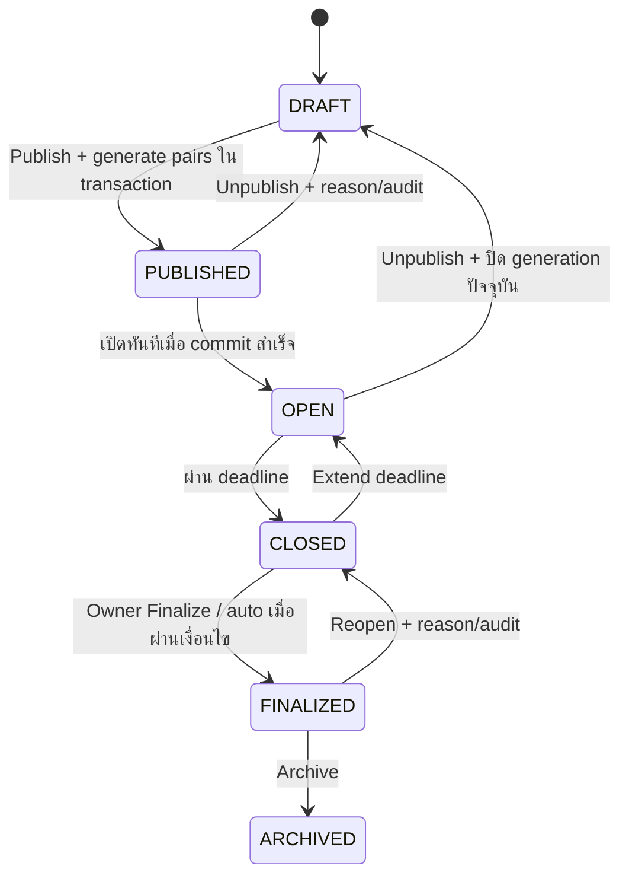
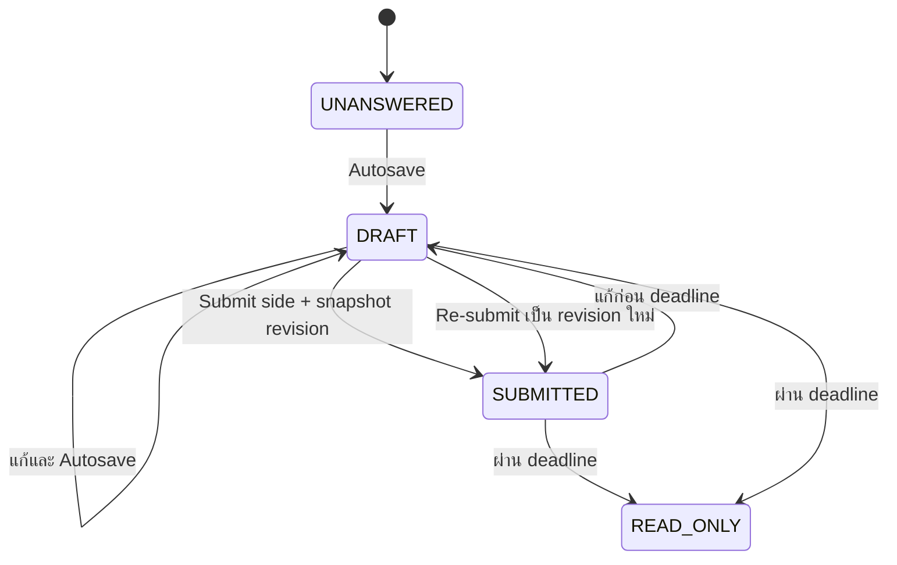
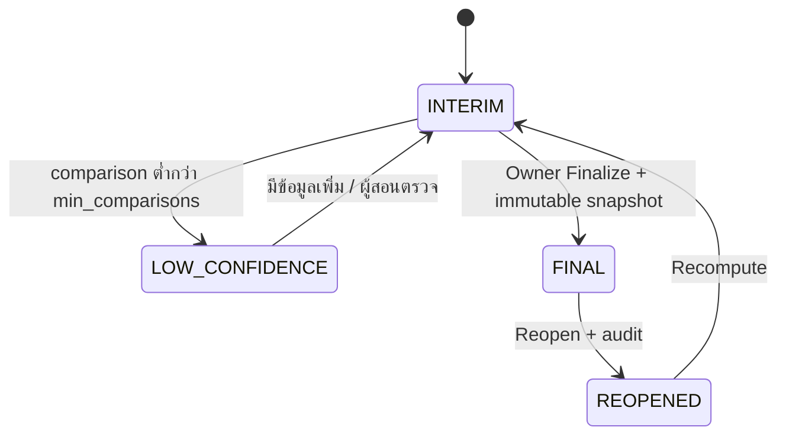

# 11 — State Diagram: งาน คำตอบ และคะแนน

**ฐานอ้างอิง:** [PRD v2.1](pairwise_evaluation_prd%201.md) หัวข้อ 7.3, หัวข้อ 7.5, หัวข้อ 9, หัวข้อ 11 · **สถานะ:** State เป้าหมายของระบบเต็ม

## Assignment lifecycle

ก่อน Publish ตรวจน้ำหนักเกณฑ์และ feasibility (FR-ASSIGN-02, FR-PAIR-04); `individual_max_score=0` ไม่สร้างคู่ Individual (FR-ASSIGN-07). ตาม [DQ-13](13_Decisions%20Needed.md) Publish เปิดประเมินทันทีเมื่อ transaction สำเร็จ; แต่ละ side ปิดตาม deadline ของตน และงาน `CLOSED` หลัง side สุดท้ายปิด. หลัง Unpublish ต้อง **soft-invalidate generation ปัจจุบัน** เก็บคู่, submission และ snapshot เดิมเพื่อ audit แล้ว Publish ใหม่ด้วย generation ใหม่ (DQ-09, DR-02/03); ข้อความ “ลบ pairs” ใน PRD ต้องแก้. [OQ-3](13_Decisions%20Needed.md) ให้ auto-finalize ทั้งงานหลัง deadline สุดท้าย 14 วันเฉพาะเมื่อไม่มี LOW_CONFIDENCE, appeal เปิด หรือ validation error มิฉะนั้นคง `CLOSED` และแจ้ง Owner. ทั้งหมดนี้ยังเป็นกติกาสำหรับพัฒนา ไม่ใช่สถานะที่ Demo ทำแล้ว

## คำตอบและ revision

`SUBMITTED` ในภาพหมายถึงมี revision ที่ส่งแล้ว การกลับไปแก้เป็น Draft **ไม่แก้ revision เดิม** จนกว่าจะ Re-submit คะแนนยังใช้ revision ล่าสุดที่ส่งแล้ว (FR-EVAL-04–09, DR-01/06) Group และ Individual มีการ Submit และ deadline แยกกัน

## คะแนน

นักศึกษาอาจยังไม่เห็น Individual Interim เพราะ `k_min` ยังไม่ถึง (FR-ANON-02); `Final` ของ PRD v2.1 หมายถึง Owner กด Finalize แล้ว **ต่างจากเดโม** ที่ป้าย Final อิง deadline และความครบของข้อมูล
